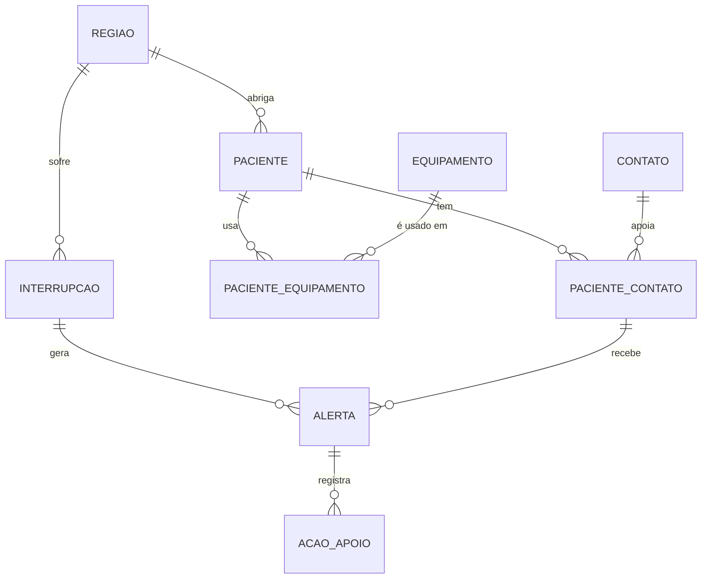

# Modelo de dados — LuzVital

**Status:** v1 **aprovada** (13/11/2026). Implementada em `database/ddl.sql`, `dml.sql` e `dql.sql`.
Depois de aprovada, esta proposta vira o diagrama lógico no **Oracle Data Modeler**, e o diagrama passa a ser a fonte oficial.
Toda mudança aqui afeta: `database/*.sql`, camada `model`/`dao` do backend, DER e diagrama de classes do PDF de DDD, `docs/API_CONTRACT.md` e o notebook de Data Science.

## 1. Visão geral

São 9 tabelas, normalizadas até a 3FN:

| Tabela | Para que serve |
|---|---|
| `REGIAO` | Bairro ou área usada para cruzar a interrupção com os pacientes |
| `PACIENTE` | Paciente eletrodependente (dados **fictícios**), com o endereço |
| `EQUIPAMENTO` | Catálogo de tipos de equipamento médico e o consumo de cada um |
| `PACIENTE_EQUIPAMENTO` | Equipamento que um paciente usa, com a autonomia da bateria **daquela unidade** |
| `CONTATO` | Familiar, cuidador ou equipe de saúde |
| `PACIENTE_CONTATO` | Liga paciente e contato, com a ordem de acionamento |
| `INTERRUPCAO` | Falta de energia numa região (no MVP, **simulada**) |
| `ALERTA` | Aviso gerado para um contato de um paciente afetado; inclui a confirmação |
| `ACAO_APOIO` | Andamento: o que foi feito depois do alerta |

## 2. Tabelas e colunas

Convenções: PK `NUMBER GENERATED BY DEFAULT AS IDENTITY`; constraints nomeadas `pk_`, `fk_`, `ck_`, `uq_`; flags como `CHAR(1)` com `CHECK ('S','N')`.

### REGIAO
| Coluna | Tipo | Regra |
|---|---|---|
| id_regiao | NUMBER | PK |
| nome | VARCHAR2(80) | NOT NULL |
| cidade | VARCHAR2(80) | NOT NULL |
| uf | CHAR(2) | NOT NULL |
| | | `uq_regiao_nome_cidade (nome, cidade)` |

### PACIENTE
| Coluna | Tipo | Regra |
|---|---|---|
| id_paciente | NUMBER | PK |
| nome | VARCHAR2(120) | NOT NULL, fictício |
| data_nascimento | DATE | NOT NULL |
| logradouro | VARCHAR2(120) | NOT NULL |
| numero | VARCHAR2(10) | NOT NULL |
| complemento | VARCHAR2(60) | NULL |
| cep | CHAR(8) | NOT NULL, só dígitos |
| id_regiao | NUMBER | FK → REGIAO, NOT NULL |
| observacao_atendimento | VARCHAR2(255) | NULL — só o essencial para quem vai ajudar (ex.: "acesso por escada") |
| ativo | CHAR(1) | `S`/`N`, default `S` |
| data_cadastro | TIMESTAMP | default `SYSTIMESTAMP` |

### EQUIPAMENTO (catálogo)
| Coluna | Tipo | Regra |
|---|---|---|
| id_equipamento | NUMBER | PK |
| nome | VARCHAR2(80) | NOT NULL, único |
| categoria | VARCHAR2(30) | CHECK em (`RESPIRATORIO`, `ALIMENTACAO`, `MONITORAMENTO`, `OUTRO`) |
| consumo_watts | NUMBER(6) | > 0 |
| suporte_vida | CHAR(1) | `S`/`N` — informação do fabricante ou cadastro, **não** é avaliação clínica |

### PACIENTE_EQUIPAMENTO
| Coluna | Tipo | Regra |
|---|---|---|
| id_paciente_equipamento | NUMBER | PK |
| id_paciente | NUMBER | FK → PACIENTE |
| id_equipamento | NUMBER | FK → EQUIPAMENTO |
| autonomia_bateria_min | NUMBER(5) | ≥ 0 (0 = sem bateria) |
| fonte_alternativa | VARCHAR2(60) | NULL (ex.: "nobreak", "gerador") |

### CONTATO
| Coluna | Tipo | Regra |
|---|---|---|
| id_contato | NUMBER | PK |
| nome | VARCHAR2(120) | NOT NULL, fictício |
| tipo | VARCHAR2(20) | CHECK em (`FAMILIAR`, `CUIDADOR`, `EQUIPE_SAUDE`) |
| telefone | VARCHAR2(20) | NOT NULL, fictício |
| email | VARCHAR2(120) | NULL |

### PACIENTE_CONTATO
| Coluna | Tipo | Regra |
|---|---|---|
| id_paciente | NUMBER | PK, FK → PACIENTE |
| id_contato | NUMBER | PK, FK → CONTATO |
| ordem_acionamento | NUMBER(2) | ≥ 1 (1 = acionar primeiro) |
| vinculo | VARCHAR2(40) | ex.: "filha", "cuidadora diurna" |

### INTERRUPCAO
| Coluna | Tipo | Regra |
|---|---|---|
| id_interrupcao | NUMBER | PK |
| id_regiao | NUMBER | FK → REGIAO |
| data_inicio | TIMESTAMP | NOT NULL |
| data_fim | TIMESTAMP | NULL enquanto aberta; ≥ data_inicio |
| duracao_estimada_min | NUMBER(5) | NULL, > 0 |
| origem | VARCHAR2(20) | CHECK em (`SIMULADA`, `MANUAL`, `DISPOSITIVO`) |
| status | VARCHAR2(15) | CHECK em (`ABERTA`, `ENCERRADA`) |

### ALERTA
| Coluna | Tipo | Regra |
|---|---|---|
| id_alerta | NUMBER | PK |
| id_interrupcao | NUMBER | FK → INTERRUPCAO |
| id_paciente | NUMBER | FK composta (id_paciente, id_contato) → PACIENTE_CONTATO |
| id_contato | NUMBER | (idem) |
| prioridade | NUMBER(1) | CHECK 1 a 3 (ver seção 4) |
| status | VARCHAR2(15) | CHECK em (`PENDENTE`, `CONFIRMADO`, `SEM_RESPOSTA`) |
| data_criacao | TIMESTAMP | default `SYSTIMESTAMP` |
| data_confirmacao | TIMESTAMP | NULL; obrigatório quando status = `CONFIRMADO` |
| | | `uq_alerta (id_interrupcao, id_paciente, id_contato)` |

### ACAO_APOIO
| Coluna | Tipo | Regra |
|---|---|---|
| id_acao | NUMBER | PK |
| id_alerta | NUMBER | FK → ALERTA |
| tipo | VARCHAR2(30) | CHECK em (`CONTATO_REALIZADO`, `DESLOCAMENTO`, `ENERGIA_RESTABELECIDA`, `ORIENTADO_SAMU_192`, `OUTRO`) |
| descricao | VARCHAR2(255) | NOT NULL |
| data_registro | TIMESTAMP | default `SYSTIMESTAMP` |

## 3. Decisões em relação à lista inicial de entidades

| Entidade sugerida | Decisão | Por quê |
|---|---|---|
| ENDERECO | Incorporada em `PACIENTE` | No MVP cada paciente tem um endereço só (1:1). Uma tabela separada não traz ganho e complica o CRUD |
| EQUIPE_SAUDE | Virou `CONTATO.tipo = 'EQUIPE_SAUDE'` | Para o fluxo de alertas, a equipe é um contato acionável como os outros |
| CONFIRMACAO_ALERTA | Incorporada em `ALERTA` | Cada alerta é confirmado no máximo uma vez (1:1). O andamento fica em `ACAO_APOIO` |
| OCORRENCIA_ENERGIA | Virou `INTERRUPCAO` | Nome mais claro. "Ocorrência" ficava ambíguo com as ações de apoio |
| USUARIO | **Fora do MVP** | Login e perfis estão como "Could"/futuro. Entra depois sem mudar as outras tabelas |
| REGIAO | **Nova** | É a chave do cruzamento interrupção → pacientes. Sem ela, a região seria texto livre repetido |

## 4. Regra operacional de prioridade (não é índice clínico)

Calculada pelo backend (BO) quando os alertas são criados, usando o equipamento do paciente com **menor autonomia**:

| Prioridade | Condição |
|---|---|
| 1 | Usa equipamento com `suporte_vida = 'S'` **e** autonomia < duração estimada (ou duração desconhecida) |
| 2 | Autonomia < duração estimada (ou desconhecida) |
| 3 | Demais casos |

É uma regra acadêmica para ordenar avisos. Ela **não** substitui avaliação profissional.

## 5. Dados de exemplo (DML)

- Todos fictícios, sem CPF.
- Regiões: 5 bairros de São Paulo (fictícios na combinação com os pacientes).
- ≥ 5 linhas por tabela.
- Os dados precisam deixar o LEFT JOIN interessante: por exemplo, 1 paciente sem nenhum alerta e 1 interrupção numa região sem pacientes.

## 6. Ideias para as 3 consultas (DQL)

1. **INNER JOIN:** pacientes e a região em que moram (`PACIENTE` × `REGIAO`).
2. **INNER JOIN + GROUP BY:** quantidade de alertas por status em cada interrupção (`INTERRUPCAO` × `ALERTA`, `COUNT`).
3. **LEFT OUTER JOIN + WHERE + ORDER BY:** pacientes ativos e seus alertas, incluindo quem não recebeu nenhum, ordenados pela prioridade (`PACIENTE` ⟕ `ALERTA`).

## 7. Impacto nas outras partes

| Parte | O que muda |
|---|---|
| Backend | Uma classe model por tabela; DAO JDBC por tabela; a BO de interrupção cria os alertas |
| API (`API_CONTRACT.md`) | Acrescentar `/equipamentos` (catálogo) e `/regioes`; `/pacientes/{id}/equipamentos` passa a usar `PACIENTE_EQUIPAMENTO` |
| Data Science | Usa `duracao_estimada_min` e `autonomia_bateria_min` como conceitos |
| Dynamic Programming | Usa `autonomia_bateria_min` e `prioridade` na distribuição de kits |

## 8. Pontos para revisar

- [x] As 9 tabelas e as decisões da seção 3 (aprovado em 13/11).
- [x] Padrão de nomes: **sem prefixo** (como nesta proposta).
- [x] PK com `GENERATED BY DEFAULT AS IDENTITY`. O `dml.sql` insere IDs explícitos e depois ajusta as IDENTITY com `START WITH LIMIT VALUE`.

## 9. Regras extras implementadas no DDL

- `uq_pac_contato_ordem`: um paciente não tem dois contatos com a mesma ordem de acionamento.
- `ck_interrupcao_fim`: interrupção `ABERTA` não tem `data_fim`; `ENCERRADA` precisa ter.
- `ck_paciente_cep`: CEP com exatamente 8 dígitos.
- `fk_pac_equip_paciente ON DELETE CASCADE`: remover o paciente remove os equipamentos dele. As demais FKs bloqueiam a exclusão (a API devolve 409); para pacientes, preferir desativar (`ativo = 'N'`).
