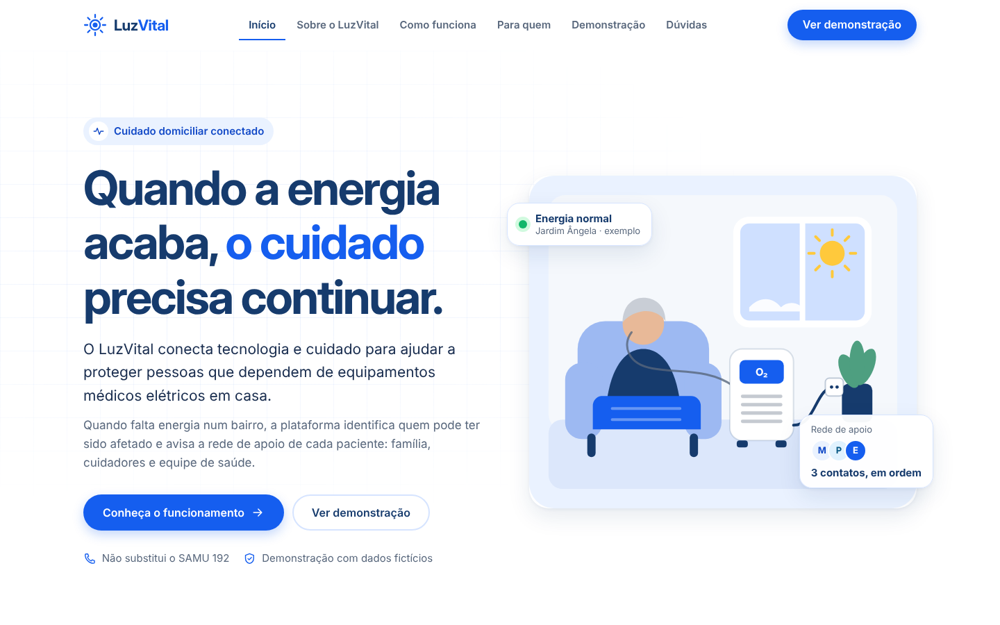
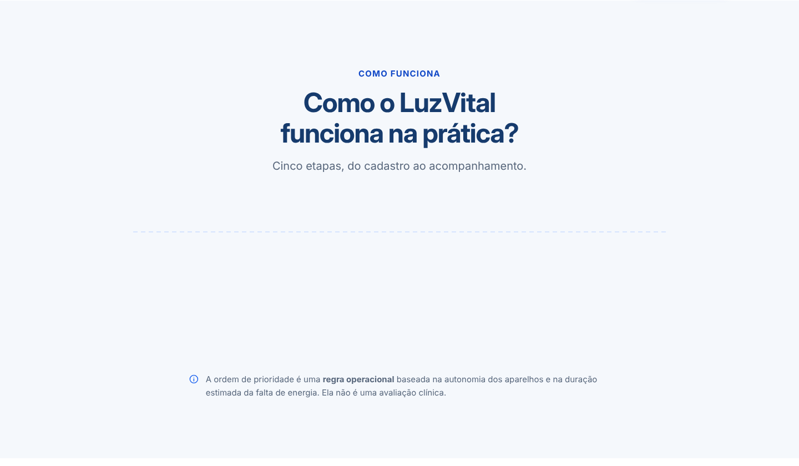
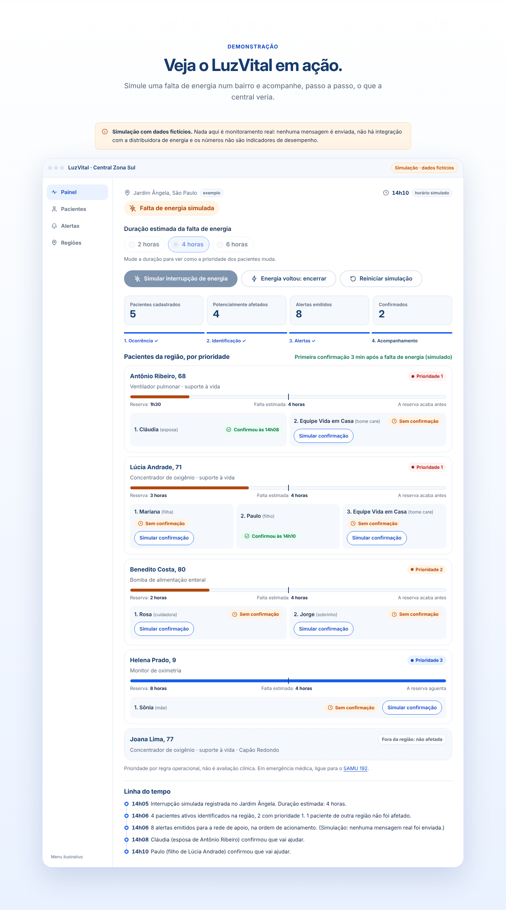
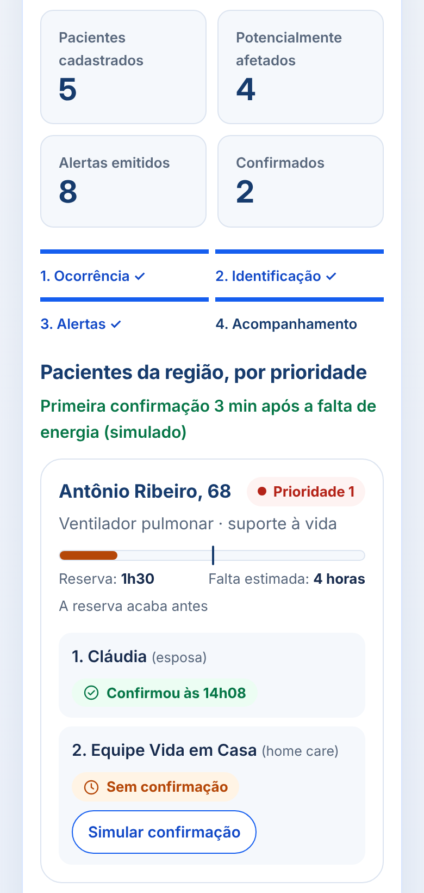
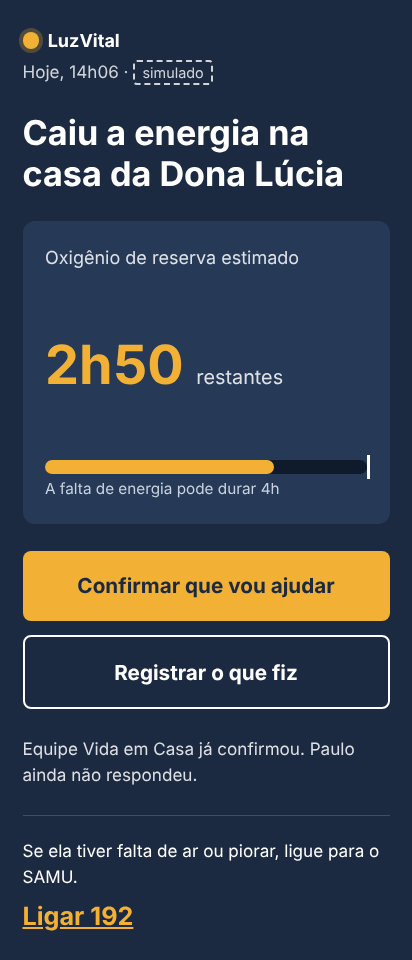

# 5. Protótipo — LuzVital

Item 5 da entrega de Agile Methodology (20 pontos).

As telas abaixo são do **site real da LuzVital**, publicado em **https://luzvital.onrender.com** (HTML, CSS e JavaScript puro, servido pelo backend Spring Boot). A demonstração usa **dados fictícios** e funciona sem enviar nenhuma mensagem real.

Este item substitui o protótipo inicial de 13/11 (`frontend/prototipo/`), que serviu de rascunho. A tela de alerta no celular do contato ainda não existe no site, então ela aparece aqui no formato de protótipo, como próxima etapa.

## Decisões de UX que valem para todas as telas

| Decisão | Por quê | Persona |
|---|---|---|
| Fonte **Inter**, textos curtos e linguagem simples ("Quando a energia acaba, o cuidado precisa continuar") | O cidadão não é especialista. Nada de "interrupção de fornecimento" ou "ID do contato" | Mariana, Dona Lúcia |
| Azul de confiança como cor principal; **vermelho, laranja e verde só para estado** (prioridade 1, sem confirmação, confirmado) | A cor tem significado fixo e sempre vem acompanhada de texto, para não depender só da cor (daltonismo) | Rafael |
| Avisos fixos: "Não substitui o SAMU 192" e "Demonstração com dados fictícios" | A LuzVital não é serviço de emergência, e uma simulação não deve parecer integração real | Todas |
| Prioridade sempre com a frase "regra operacional, não é avaliação clínica" | Deixa claro que a ordem dos alertas não é diagnóstico | Rafael |
| Acessibilidade: link "Pular para o conteúdo principal", foco visível no teclado, rótulos para leitores de tela (atributos `aria`) e animações reduzidas quando o sistema pede | O público inclui pessoas idosas e com deficiência | Dona Lúcia |
| Layout que se reorganiza em uma coluna no celular | Quem cuida do paciente usa principalmente o celular | Mariana |

## Tela 1 — Página inicial

**Histórias relacionadas:** visão geral do produto (porta de entrada para US04–US08).

**Intenção:** em poucos segundos, dizer **para quem** é a LuzVital e **o que ela faz**, sem jargão técnico.

**Adequação da UX:**
- O título fala do sentimento do problema ("Quando a energia acaba, o cuidado precisa continuar"), e o parágrafo seguinte explica a solução em uma frase.
- A ilustração mostra uma paciente com o concentrador de oxigênio, o indicador "Energia normal" e a "Rede de apoio: 3 contatos, em ordem". É o produto resumido numa imagem.
- Dois caminhos claros: "Conheça o funcionamento" e "Ver demonstração", com um destaque visual só no principal.
- Os avisos "Não substitui o SAMU 192" e "Demonstração com dados fictícios" aparecem logo na primeira tela.

## Tela 2 — Como funciona

**Histórias relacionadas:** US01–US03 (cadastro), US04–US06 (interrupção, identificação e prioridade), US07–US08 (alerta e acompanhamento).

**Intenção:** explicar o fluxo completo em **cinco etapas numeradas**, do cadastro ao acompanhamento.

**Adequação da UX:**
- A numeração é usada porque o conteúdo **é** uma sequência: cadastro, monitoramento, identificação, alertas e acompanhamento.
- Cada etapa tem um título de uma palavra e uma frase curta. A etapa de monitoramento diz claramente que hoje a interrupção é informada "de forma manual ou simulada".
- O aviso sobre a prioridade como regra operacional fica logo abaixo das etapas.

## Tela 3 — Painel da central (demonstração)

**Histórias relacionadas:** US04, US05, US06, US07 e US08 (Must, MVP). **Casos de uso:** UC07, UC08, UC09, UC11, UC13.

**Intenção:** mostrar o que o operador da central (persona Rafael) vê quando falta energia num bairro: **quem foi afetado, quem precisa de ajuda primeiro e quem já confirmou**.

**Adequação da UX:**
- O operador escolhe a duração estimada da falta de energia (2, 4 ou 6 horas) e vê a prioridade mudar. Isso mostra que a ordem depende da autonomia da bateria de cada paciente.
- Quatro números no topo resumem a situação: pacientes cadastrados, potencialmente afetados, alertas emitidos e confirmados.
- Uma barra de etapas (ocorrência, identificação, alertas, acompanhamento) mostra em que ponto o atendimento está.
- A lista já vem **ordenada por prioridade**. Cada paciente tem uma barra que compara a reserva da bateria com a falta estimada e uma frase simples: "A reserva acaba antes".
- Os contatos aparecem na ordem de acionamento, com "Sem confirmação" em laranja e "Confirmou às 14h08" em verde.
- A **linha do tempo** registra cada passo com o horário. Ela também alimenta o indicador de impacto: o tempo até a primeira confirmação.
- Um paciente de outra região aparece marcado como "Fora da região: não afetado", para mostrar que o cruzamento é por região.

## Tela 4 — O mesmo painel no celular

**Histórias relacionadas:** US07 e US08. **Persona:** Mariana e Rafael fora da central.

**Intenção:** o acompanhamento precisa funcionar numa tela pequena, porque numa falta de energia o celular pode ser o único aparelho ligado.

**Adequação da UX:**
- Os números viram uma grade de 2×2 e os cartões dos pacientes ocupam a largura toda. Não há rolagem lateral.
- Os botões têm área de toque grande e texto que diz exatamente o que acontece.
- A frase "Primeira confirmação 3 min após a falta de energia (simulado)" mostra o indicador de impacto em linguagem comum.

## Tela 5 — Alerta no celular do contato (próxima etapa)

**Histórias relacionadas:** US07 (Must), US11 e US12 (Should). **Casos de uso:** UC10, UC11, UC12, UC15.

**Intenção:** a Mariana entende o que aconteceu, quanto tempo há e o que fazer, com **um toque**. No site atual a confirmação é simulada pelo botão "Simular confirmação" do painel; esta tela mostra como ela chegaria ao contato.

**Adequação da UX:**
- **Fundo escuro:** durante a falta de energia, o celular pode ser a única luz e a bateria importa.
- O título diz **quem** e **o quê** em linguagem de família: "Caiu a energia na casa da Dona Lúcia".
- O tempo de reserva restante aparece em destaque, com a mesma barra de autonomia do painel.
- O botão principal ocupa toda a largura, fica na zona do polegar e diz o que acontece: "Confirmar que vou ajudar".
- A linha "Equipe Vida em Casa já confirmou. Paulo ainda não respondeu." evita que todos corram ao mesmo tempo ou que ninguém vá.
- "Ligar 192" é um link de discagem direta. A paciente (Dona Lúcia) **não precisa operar nada**.

## Ligação com o restante do projeto

| Tela | O que já existe na API (`/api`) | O que ainda é simulado no site |
|---|---|---|
| Painel | `POST /api/interrupcoes` registra a interrupção e gera os alertas priorizados; `GET /api/interrupcoes/{id}` consulta; `/api/pacientes` e `/api/regioes` têm CRUD completo | A confirmação dos alertas ("Simular confirmação") e a linha do tempo |
| Alerta no celular | — | Tela inteira (próxima etapa: endpoint de confirmação do alerta, US07) |
