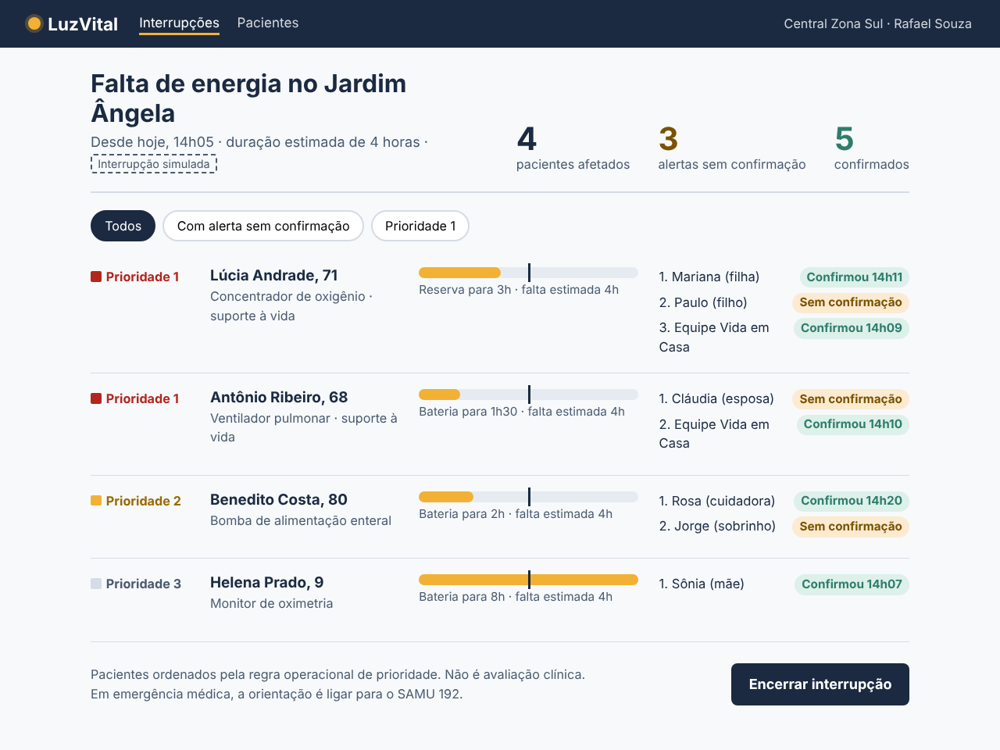
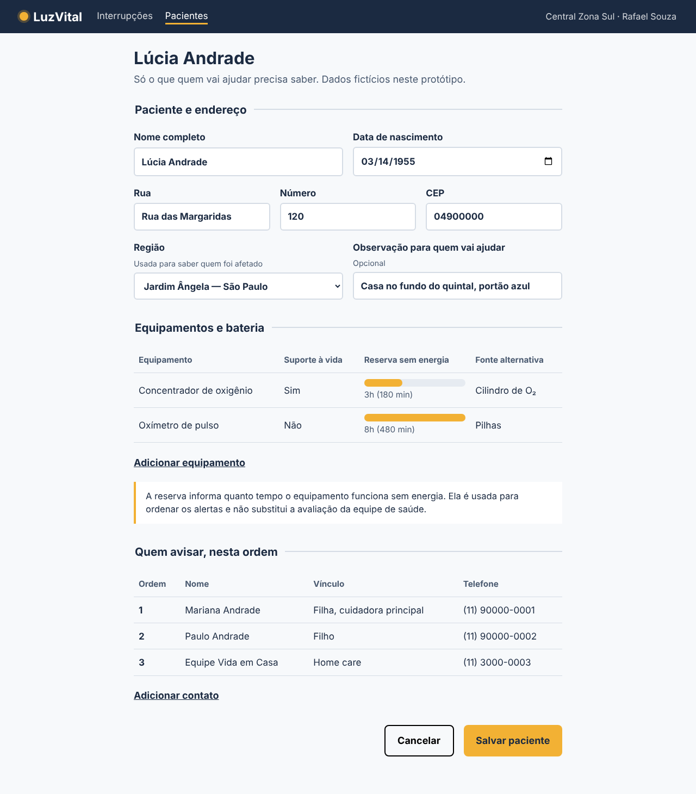

# 5. Protótipo — LuzVital

Item 5 da entrega de Agile Methodology (20 pontos).

- **Protótipo navegável:** `frontend/prototipo/index.html`. Abra no navegador; não precisa de servidor.
- **Imagens para o PDF:** `docs/agile/img/tela_*.png`.
- Todos os dados são **fictícios** e coerentes com as personas e com o DML.

> ⚠️ **Lembrete (decisão de 13/11/2026):** estas telas são o protótipo de Agile. Quando o backend Java estiver pronto, **atualizar as telas para o MVP oficial**: os mesmos campos e nomes da API, e telas ligadas aos endpoints reais. Os prints do PDF de DDD-Java devem sair dessa versão atualizada.

## Decisões de UX que valem para todas as telas

| Decisão | Por quê | Persona |
|---|---|---|
| Fonte **Atkinson Hyperlegible**, corpo de 18 px | Foi criada para leitores com baixa visão; letras como I, l e 1 são bem diferentes | Dona Lúcia, Mariana |
| Contraste alto (azul-noite sobre claro, branco e âmbar sobre escuro) | Leitura rápida sob estresse e em ambientes com pouca luz | Todas |
| Linguagem simples ("Caiu a energia", "Quem avisar, nesta ordem") | O cidadão não é especialista. Nada de "interrupção de fornecimento" ou "ID do contato" | Mariana |
| A **barra de autonomia** aparece nas três telas | Mostra num olhar se a bateria aguenta a falta de energia (barra) ou não (barra antes do traço) | Rafael, Mariana |
| Selo **"simulado"** visível | Não apresentamos uma integração simulada como real | — |
| A orientação **SAMU 192** está sempre presente | A LuzVital não é serviço de emergência; orienta a usar o canal oficial | Todas |
| A prioridade traz a frase "não é avaliação clínica" | Deixa claro que é uma regra operacional | Rafael |

## Tela 1 — Painel da interrupção (operador da central)

**Histórias:** US05, US06, US08, US09 (Must) e US13 (Should). **Casos de uso:** UC08, UC09, UC13, UC14.

**Intenção:** responder em poucos segundos às três perguntas do problema: **quem** foi afetado, **quem precisa primeiro** e **quem já está agindo**.

**Adequação da UX:**
- Os números grandes no topo (afetados, sem confirmação, confirmados) dão a situação geral antes da lista.
- A lista já vem **ordenada por prioridade**. O operador não precisa ordenar nada no meio da crise.
- A cor da prioridade sempre vem acompanhada de **texto** ("Prioridade 1"), para não depender só da cor (daltonismo).
- Todos os pacientes usam a **mesma escala de 8 horas**. O traço vertical marca a duração estimada, então dá para comparar as linhas: quem não chega ao traço precisa de ajuda antes.
- Os contatos aparecem na ordem de acionamento, com o status ao lado. "Sem confirmação" em âmbar chama a atenção sem alarmar.
- Os filtros de uma tecla atendem aos dois usos mais comuns: quem ainda não respondeu e a prioridade 1.
- "Encerrar interrupção" fica separado, no fim da página, para evitar um clique acidental.

## Tela 2 — Alerta no celular (contato de apoio)

**Histórias:** US07 (Must), US11 e US12 (Should). **Casos de uso:** UC10, UC11, UC12, UC15.

**Intenção:** a Mariana entende o que aconteceu, quanto tempo há e o que fazer, com **um toque**.

**Adequação da UX:**
- **Fundo escuro:** durante a falta de energia, o celular pode ser a única luz e a bateria importa. Em telas OLED, o fundo escuro gasta menos.
- O título diz **quem** e **o quê** em linguagem de família: "Caiu a energia na casa da Dona Lúcia".
- O dado mais importante, o **tempo de reserva restante**, aparece em tamanho grande e em âmbar.
- O botão principal ocupa toda a largura e fica na zona do polegar. O texto diz exatamente o que acontece: "Confirmar que vou ajudar". Depois do toque, aparece uma confirmação ("Você confirmou às 14h11") que também é anunciada para leitores de tela.
- A linha "Equipe Vida em Casa já confirmou. Paulo ainda não respondeu." evita que todos corram ao mesmo tempo ou que ninguém vá.
- **"Ligar 192"** é um link de discagem direta. O texto orienta sem diagnosticar.
- A paciente (Dona Lúcia) **não precisa operar nada**. O alerta vai para a rede de apoio dela.

## Tela 3 — Cadastro do paciente (equipe de home care)

**Histórias:** US01, US02, US03 (Must). **Casos de uso:** UC01, UC03, UC04.

**Intenção:** registrar, numa só página, tudo o que o cruzamento e os alertas precisam, e **nada além disso**.

**Adequação da UX:**
- O subtítulo "Só o que quem vai ajudar precisa saber" aplica a **minimização de dados da LGPD**. Não há campos de diagnóstico, CPF ou prontuário.
- Os campos usam os mesmos nomes do modelo de dados (região, reserva, ordem), para manter a coerência com o banco e a API.
- A **região** explica para que serve ("Usada para saber quem foi afetado"), porque é o campo que faz o cruzamento funcionar.
- Os equipamentos mostram a reserva em horas **e** em minutos, a unidade do banco. Assim a equipe confere o valor sem fazer contas.
- O título "Quem avisar, nesta ordem" transforma o conceito técnico "ordem de acionamento" numa instrução.
- Um aviso em destaque lembra que a reserva só ordena alertas e não substitui a avaliação da equipe.
- Em telas pequenas, o layout passa a ter uma coluna só, para quem cadastra pelo celular durante a visita.

## Ligação com o restante do projeto

| Tela | Endpoints que vai consumir (`API_CONTRACT.md`) | Tabelas (`DATABASE_MODEL.md`) |
|---|---|---|
| Painel | `GET /interrupcoes/{id}`, `GET /alertas?interrupcao={id}`, `PUT /interrupcoes/{id}` | INTERRUPCAO, ALERTA, PACIENTE, PACIENTE_EQUIPAMENTO, CONTATO |
| Alerta | `GET /alertas/{id}`, `PUT /alertas/{id}/confirmar` | ALERTA, ACAO_APOIO |
| Cadastro | `POST/PUT /pacientes`, `/pacientes/{id}/equipamentos`, `/contatos` | PACIENTE, REGIAO, PACIENTE_EQUIPAMENTO, EQUIPAMENTO, PACIENTE_CONTATO, CONTATO |
